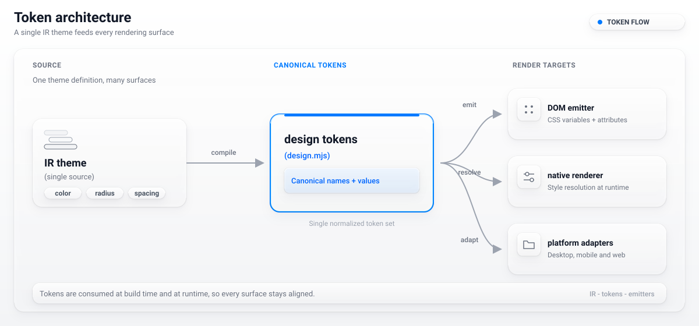
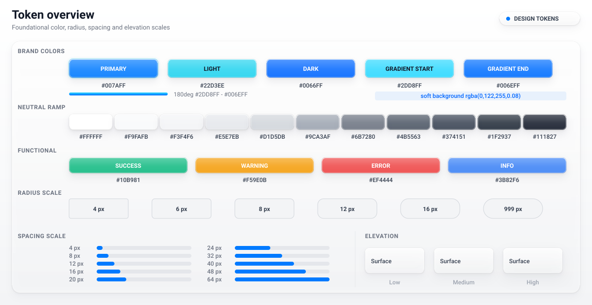
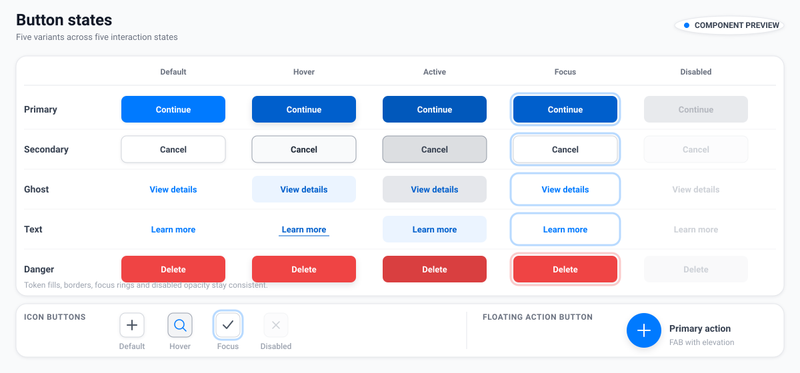
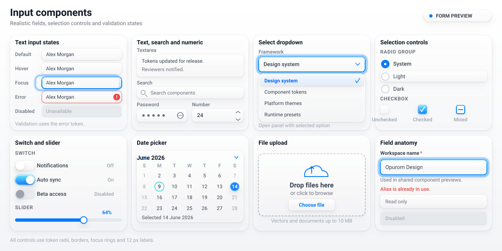
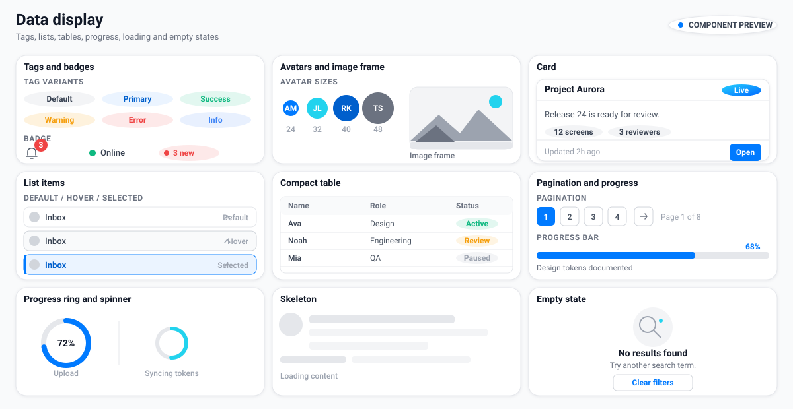
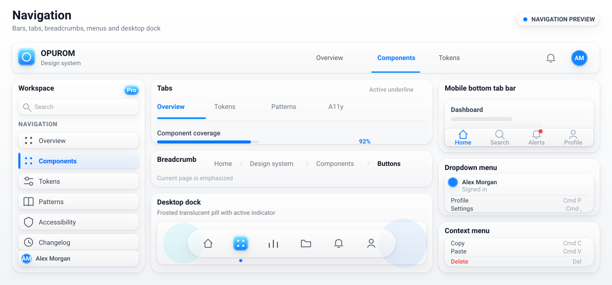
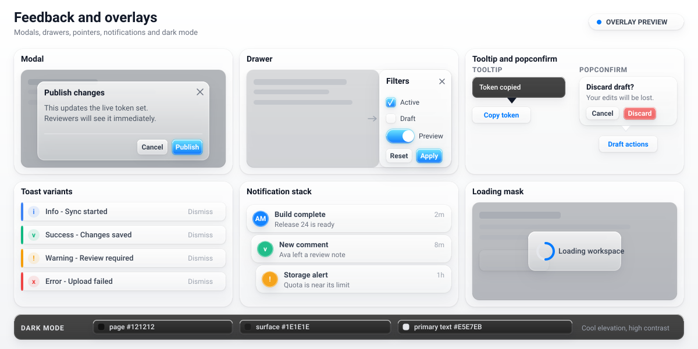
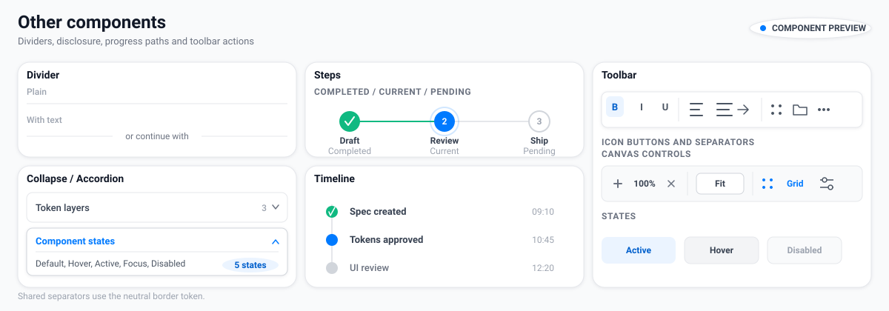

# OPUROM Default UI System (normative)

## 1. Scope and authority

This document defines the built-in default UI system for OPUROM. It is normative for default component geometry, visual state, responsive layout, dark mode, and interaction behavior across every target lowered from OPUROM IR. IR is the only inter-layer contract. Design tokens are the single source of truth for default visual values. The compiler lowers component declarations, state plans, and token references to target-native CSS, layout data, and drawing instructions at compile time; no target ships a runtime IR interpreter.

The token system has two layers. The foundational `--opurom-color-*` palette holds the FRAMEWORK DEFAULTS emitted by `opurom-web/lib/design.mjs`. An IR `theme.accent` overrides the instance-level `--opurom-primary` at emit time; `--opurom-surface`, `--opurom-on-surface`, `--opurom-elevation-1..3`, and `--opurom-radius-1..4` are theme-derived instance tokens. Those instance tokens are projections of the IR theme and are not additional palette sources. The default UI system's brand accent is `--opurom-color-primary` (`#007AFF`). The shipped compiler default accent is `#097FEB` in `opurom-lang/src/lower.rs`; the component catalog's brand-accent defaults in `opurom-spec/components.json` use the same value. Those shipped defaults are distinct from the foundational palette and are not redefined here. No component reads a hardcoded primary value.

Brand provenance is the cool blue-cyan pair recorded as `BRAND_ORIGIN` and `BRAND_TERMINAL` in Section 2. The primary, primary-light, and primary-dark tokens derive from that pair. Liquid Glass is the default material language: a translucent frosted lamina with backdrop blur/saturate, a specular inner edge, and restrained accent. Two-colour gradients are reserved for emphasis, hero, and active elements only and MUST NOT be used as full-bleed backgrounds. Surfaces are single-hue or white. Depth comes from elevation plus glass, not clashing gradients.

The component contract is catalog v0.3 in `opurom-spec/components.json`: 260 named components and 100 distinct drawn primitives. Section 4 specifies 53 default UI component forms in six categories; component aliases in the catalog lower to those forms. The five shared responsive tiers are Compact `<600`, Medium `<900`, Expanded `<1200`, Wide `<1600`, and Ultra `>=1600` logical pixels. The compiler, `opurom-render/src/layout.rs`, and the DOM emitter use the same thresholds.

Figure 1. Token authority, IR lowering, and target emitters.

## 2. Foundational tokens

Every CSS custom property in this section is emitted by `opurom-web/lib/design.mjs` and maps to its token group there. All component styles in this document trace back to these tokens, to the section constants defined below, or to the state/size records in Section 3 that expand only to these tokens. Whitespace in `rgba()` and `linear-gradient()` serializations is not semantically significant. Values below are the authoritative literals.

### 2.1 Primary and brand provenance

| Token / constant | Value | Role |
| --- | --- | --- |
| `--opurom-color-primary` | `#007AFF` | Default brand accent |
| `--opurom-color-primary-light` | `#22D3EE` | Cool endpoint and focus/hover accent |
| `--opurom-color-primary-dark` | `#005FCC` | Pressed and high-emphasis accent |
| `--opurom-color-primary-gradient` | `linear-gradient(135deg, #25D1FF 0%, #0066FF 100%)` | Reserved emphasis, hero, and active gradient |
| `--opurom-color-primary-soft` | `rgba(0, 122, 255, 0.08)` | Accent tint for soft fills |
| `--opurom-color-on-primary` | `#FFFFFF` | Text and icon on accent fills |
| `BRAND_ORIGIN` | `#0070E0` | Official logo deep-blue measurement; not emitted as a CSS custom property |
| `BRAND_TERMINAL` | `#10D0E0` | Official logo cyan measurement; not emitted as a CSS custom property |

### 2.2 Neutral palette

| Token | Value |
| --- | --- |
| `--opurom-color-white` | `#FFFFFF` |
| `--opurom-color-gray-50` | `#F9FAFB` |
| `--opurom-color-gray-100` | `#F3F4F6` |
| `--opurom-color-gray-200` | `#E5E7EB` |
| `--opurom-color-gray-300` | `#D1D5DB` |
| `--opurom-color-gray-400` | `#9CA3AF` |
| `--opurom-color-gray-500` | `#6B7280` |
| `--opurom-color-gray-600` | `#4B5563` |
| `--opurom-color-gray-700` | `#374151` |
| `--opurom-color-gray-800` | `#1F2937` |
| `--opurom-color-gray-900` | `#111827` |

### 2.3 Functional palette

| Token | Value |
| --- | --- |
| `--opurom-color-success` | `#10B981` |
| `--opurom-color-success-soft` | `rgba(16,185,129,0.08)` |
| `--opurom-color-warning` | `#F59E0B` |
| `--opurom-color-warning-soft` | `rgba(245,158,11,0.08)` |
| `--opurom-color-error` | `#EF4444` |
| `--opurom-color-error-soft` | `rgba(239,68,68,0.08)` |
| `--opurom-color-info` | `#3B82F6` |
| `--opurom-color-info-soft` | `rgba(59,130,246,0.08)` |

### 2.4 Typography

| Token | Value | Role |
| --- | --- | --- |
| `--opurom-font-system` | `-apple-system, BlinkMacSystemFont, "PingFang SC", "Hiragino Sans GB", "Microsoft YaHei", "Microsoft JhengHei", "Segoe UI", Roboto, "Noto Sans CJK SC", "Source Han Sans SC", "Helvetica Neue", Arial, sans-serif` | System stack with CJK fallbacks |
| `--opurom-font-size-12` | `12px` | Caption and compact metadata |
| `--opurom-font-size-13` | `13px` | Small control label |
| `--opurom-font-size-14` | `14px` | Default control and body label |
| `--opurom-font-size-16` | `16px` | Large control label and body text |
| `--opurom-font-size-18` | `18px` | Subsection heading |
| `--opurom-font-size-20` | `20px` | Section heading |
| `--opurom-font-size-24` | `24px` | Card heading |
| `--opurom-font-size-30` | `30px` | Page heading |
| `--opurom-font-size-36` | `36px` | Hero heading |
| `--opurom-font-weight-400` | `400` | Body weight |
| `--opurom-font-weight-500` | `500` | Medium emphasis |
| `--opurom-font-weight-600` | `600` | Control and heading weight |
| `--opurom-font-weight-700` | `700` | Strong emphasis |
| `--opurom-line-height-body` | `1.5` | Body line height |
| `--opurom-line-height-heading` | `1.2` | Heading line height |
| `--opurom-color-gray-700` | `#374151` | Body text |
| `--opurom-color-gray-900` | `#111827` | Heading text |
| `--opurom-color-gray-500` | `#6B7280` | Secondary text |

### 2.5 Radius

| Token | Value |
| --- | --- |
| `--opurom-radius-xs` | `4px` |
| `--opurom-radius-sm` | `6px` |
| `--opurom-radius-md` | `8px` |
| `--opurom-radius-lg` | `12px` |
| `--opurom-radius-xl` | `16px` |
| `--opurom-radius-full` | `999px` |

### 2.6 Elevation and focus

| Token | Value |
| --- | --- |
| `--opurom-shadow-l1` | `0 1px 2px rgba(17,24,39,0.06), 0 1px 1px rgba(17,24,39,0.04)` |
| `--opurom-shadow-l2` | `0 4px 8px rgba(17,24,39,0.08), 0 2px 4px rgba(17,24,39,0.06)` |
| `--opurom-shadow-l3` | `0 12px 24px rgba(17,24,39,0.12), 0 4px 8px rgba(17,24,39,0.08)` |
| `--opurom-shadow-focus` | `0 0 0 3px rgba(0,122,255,0.25)` |

### 2.7 Spacing scales

The foundational px scale uses `--opurom-spacing-N`, where `N` is the value in logical pixels. The legacy ordinal scale uses `--opurom-space-N` and remains available to existing emitters; default component styles MUST NOT use it.

| Foundational token | Value | Legacy emitter token | Value |
| --- | --- | --- | --- |
| `--opurom-spacing-4` | `4px` | `--opurom-space-1` | `4px` |
| `--opurom-spacing-8` | `8px` | `--opurom-space-2` | `8px` |
| `--opurom-spacing-12` | `12px` | `--opurom-space-3` | `12px` |
| `--opurom-spacing-16` | `16px` | `--opurom-space-4` | `16px` |
| `--opurom-spacing-20` | `20px` | `--opurom-space-6` | `24px` |
| `--opurom-spacing-24` | `24px` | `--opurom-space-8` | `32px` |
| `--opurom-spacing-32` | `32px` | `NIL` | No declaration |
| `--opurom-spacing-40` | `40px` | `NIL` | No declaration |
| `--opurom-spacing-48` | `48px` | `NIL` | No declaration |
| `--opurom-spacing-64` | `64px` | `NIL` | No declaration |

Spacing base unit: `--opurom-spacing-4` (`4px`). The full foundational scale is `4, 8, 12, 16, 20, 24, 32, 40, 48, 64` logical pixels.

### 2.8 Motion

| Token | Value | Role |
| --- | --- | --- |
| `--opurom-motion-state` | `150ms ease-out` | State changes |
| `--opurom-motion-panel` | `250ms ease-out` | Panels and pages |
| `--opurom-motion-easing` | `ease-out` | Natural ease-out timing |
| `--opurom-motion-none` | `none` | No transition; no bounce |

### 2.9 Glass lamina

| Token | Light value | Dark override | Role |
| --- | --- | --- | --- |
| `--opurom-glass-blur` | `blur(2px) saturate(1.5) contrast(1.12) brightness(1.04)` | Unchanged | Backdrop filter |
| `--opurom-glass-lamina` | `rgba(255,255,255,0.42)` | `rgba(30,35,46,0.38)` | Translucent frosted lamina |
| `--opurom-glass-specular` | `inset 0 1px 0` | Unchanged | Specular top edge geometry |
| `--opurom-glass-interior` | `inset 0 -12px 28px rgba(17,24,39,0.07)` | Unchanged | Lower interior edge |

### 2.10 Dark palette

| Token | Value | Role |
| --- | --- | --- |
| `--opurom-color-page-dark` | `#121212` | Page background |
| `--opurom-color-surface-dark` | `#1E1E1E` | Base surface |
| `--opurom-color-elevated-dark` | `#252525` | Elevated surface |
| `--opurom-color-border-dark` | `#2F2F2F` | Border and divider |
| `--opurom-color-text-dark` | `#E5E7EB` | Primary text |
| `--opurom-color-text-secondary-dark` | `#9CA3AF` | Secondary text |
| `--opurom-color-text-muted-dark` | `#6B7280` | Muted and disabled text |

### 2.11 Theme-derived instance and state aliases

These tokens are emitted by `opurom-web/lib/design.mjs` from IR theme data. They are not additional foundational values and do not override Section 2 defaults outside their emit-time instance scope.

| Token | Source | Role |
| --- | --- | --- |
| `--opurom-primary` | `IR theme.accent` | Instance accent |
| `--opurom-surface` | `IR theme surface` | Instance surface |
| `--opurom-on-surface` | `IR theme onSurface` | Instance foreground |
| `--opurom-elevation-1..3` | Theme-derived shadow tiers | Instance elevation |
| `--opurom-radius-1..4` | Theme-derived radius tiers | Instance radii |
| `--opurom-state-hover` | Theme-derived hover overlay | Hover state layer |
| `--opurom-state-press` | Theme-derived pressed overlay | Active/pressed state layer |
| `--opurom-state-focus` | Theme-derived focus overlay | Focus-visible state layer |
| `--opurom-state-disabled` | Theme-derived disabled overlay | Disabled state layer |

### 2.12 Layout, interaction, and derived-value constants

These are compile-time constants in this specification, not additional CSS custom properties. Every literal below is defined here and every token reference resolves to Section 2.

| Constant | Value |
| --- | --- |
| `NIL` | No declaration |
| `LAYOUT_GRID_COLUMNS` | `12` |
| `LAYOUT_GRID_GUTTER` | `var(--opurom-spacing-24)` |
| `LAYOUT_MIN_COLUMN_WIDTH` | `120px` |
| `LAYOUT_CONTENT_MAX` | `1200px` |
| `LAYOUT_TOUCH_MIN` | `44px` |
| `LAYOUT_BREAKPOINT_COMPACT` | `600px` |
| `LAYOUT_BREAKPOINT_MEDIUM` | `900px` |
| `LAYOUT_BREAKPOINT_EXPANDED` | `1200px` |
| `LAYOUT_BREAKPOINT_WIDE` | `1600px` |
| `LAYOUT_COLUMN_COMPACT` | `1` |
| `LAYOUT_COLUMN_MEDIUM` | `2` |
| `LAYOUT_COLUMN_EXPANDED` | `12` |
| `LAYOUT_GRID_ONE_FR` | `1fr` |
| `LAYOUT_SAFE_AREA_TOP` | `env(safe-area-inset-top, var(--opurom-spacing-4))` |
| `LAYOUT_SAFE_AREA_RIGHT` | `env(safe-area-inset-right, var(--opurom-spacing-4))` |
| `LAYOUT_SAFE_AREA_BOTTOM` | `env(safe-area-inset-bottom, var(--opurom-spacing-4))` |
| `LAYOUT_SAFE_AREA_LEFT` | `env(safe-area-inset-left, var(--opurom-spacing-4))` |
| `COMPONENT_BORDER_WIDTH` | `1px` |
| `CURSOR_POINTER` | `pointer` |
| `CURSOR_DISABLED` | `not-allowed` |
| `INTERACTION_FOCUS_RING` | `var(--opurom-shadow-focus)` |
| `INTERACTION_TRANSITION` | `var(--opurom-motion-state)` + `var(--opurom-motion-easing)` |
| `INTERACTION_PANEL_TRANSITION` | `var(--opurom-motion-panel)` + `var(--opurom-motion-easing)` |
| `DISABLED_FILL` | `var(--opurom-color-gray-100)` |
| `DISABLED_BORDER` | `var(--opurom-color-gray-200)` |
| `DISABLED_TEXT` | `var(--opurom-color-gray-400)` |
| `DISABLED_SHADOW` | `NIL` |
| `DISABLED_MOTION` | `var(--opurom-motion-none)` |
| `GLASS_EDGE_LIGHT` | `var(--opurom-glass-specular) var(--opurom-color-white), var(--opurom-glass-interior)` |
| `GLASS_EDGE_DARK` | `var(--opurom-glass-specular) var(--opurom-color-gray-300), var(--opurom-glass-interior)` |

Figure 2. Foundational token groups and their derived state records.

## 3. State model

### 3.1 Required interaction states

State codes: `D` = default, `H` = hover, `A` = active/pressed, `F` = focus-visible, `X` = disabled. All interactive components MUST implement all five states. Non-interactive display components expose the subset declared in their state mask; an omitted state is not applicable to that component. State masks are applied uniformly across component families.

| Code | State | Normative composition |
| --- | --- | --- |
| `D` | default | Uses the component row's F/B/T/S/R/Mot default-token anchors and the `D` slot of each named state vector. |
| `H` | hover | Composites `--opurom-state-hover` over the fill channel and applies the `H` slot of every named state vector. |
| `A` | active/pressed | Composites `--opurom-state-press` over the fill channel and applies the `A` slot of every named state vector. |
| `F` | focus-visible | Applies `INTERACTION_FOCUS_RING` and `--opurom-state-focus`, sets the border channel to `--opurom-color-primary-light`, and applies the `F` slot of every named state vector. |
| `X` | disabled | Replaces fill, border, text, and shadow with `DISABLED_FILL`, `DISABLED_BORDER`, `DISABLED_TEXT`, and `DISABLED_SHADOW`; sets motion to `DISABLED_MOTION` and cursor to `CURSOR_DISABLED`. |

Borders use `COMPONENT_BORDER_WIDTH`. Focus-visible MUST use `--opurom-shadow-focus`; component-specific outline colors, outline widths, and ring radii are outside this contract. Motion MUST resolve to `INTERACTION_TRANSITION` for controls and `INTERACTION_PANEL_TRANSITION` for panels and pages. `--opurom-motion-none` removes transitions for `X` and for non-animated display surfaces. No bounce curve is permitted.

### 3.2 State vectors

A state vector is a five-slot compile-time record, not an additional CSS custom property. Each slot contains only Section 2 token references or Section 2 constants. Vector order is fill, border, text, shadow, radius, motion. The `F` slot of every shadow vector includes `var(--opurom-shadow-focus)`.

| Vector | `D` | `H` | `A` | `F` | `X` |
| --- | --- | --- | --- | --- | --- |
| `F_AC` | `var(--opurom-color-primary)` | `var(--opurom-color-primary-dark)` | `var(--opurom-color-primary-gradient)` | `var(--opurom-color-primary)` | `DISABLED_FILL` |
| `F_NT` | `var(--opurom-color-white)` | `var(--opurom-color-gray-50)` | `var(--opurom-color-gray-100)` | `var(--opurom-color-white)` | `DISABLED_FILL` |
| `F_DG` | `var(--opurom-color-error)` | `var(--opurom-color-error-soft)` | `var(--opurom-color-error)` | `var(--opurom-color-error)` | `DISABLED_FILL` |
| `F_GL` | `var(--opurom-glass-lamina)` + `var(--opurom-glass-blur)` | `var(--opurom-glass-lamina)` + `var(--opurom-glass-blur)` | `var(--opurom-glass-lamina)` + `var(--opurom-glass-blur)` | `var(--opurom-glass-lamina)` + `var(--opurom-glass-blur)` | `DISABLED_FILL` |
| `F_DS` | `var(--opurom-color-gray-50)` | `var(--opurom-color-gray-100)` | `var(--opurom-color-gray-100)` | `var(--opurom-color-gray-50)` | `DISABLED_FILL` |
| `F_TX` | `NIL` | `var(--opurom-color-primary-soft)` | `var(--opurom-color-primary-soft)` | `NIL` | `NIL` |
| `F_NONE` | `NIL` | `NIL` | `NIL` | `NIL` | `NIL` |
| `B_AC` | `var(--opurom-color-primary)` | `var(--opurom-color-primary-dark)` | `var(--opurom-color-primary-dark)` | `var(--opurom-color-primary-light)` | `DISABLED_BORDER` |
| `B_NT` | `var(--opurom-color-gray-200)` | `var(--opurom-color-gray-300)` | `var(--opurom-color-gray-400)` | `var(--opurom-color-primary)` | `DISABLED_BORDER` |
| `B_DG` | `var(--opurom-color-error)` | `var(--opurom-color-error)` | `var(--opurom-color-error)` | `var(--opurom-color-primary-light)` | `DISABLED_BORDER` |
| `B_GL` | `var(--opurom-color-white)` | `var(--opurom-color-primary-light)` | `var(--opurom-color-primary)` | `var(--opurom-color-primary)` | `DISABLED_BORDER` |
| `B_DS` | `var(--opurom-color-gray-200)` | `var(--opurom-color-gray-300)` | `var(--opurom-color-gray-300)` | `var(--opurom-color-primary)` | `DISABLED_BORDER` |
| `B_TX` | `NIL` | `NIL` | `NIL` | `var(--opurom-color-primary)` | `NIL` |
| `B_NONE` | `NIL` | `NIL` | `NIL` | `NIL` | `NIL` |
| `T_AC` | `var(--opurom-color-on-primary)` | `var(--opurom-color-on-primary)` | `var(--opurom-color-on-primary)` | `var(--opurom-color-on-primary)` | `DISABLED_TEXT` |
| `T_NT` | `var(--opurom-color-gray-700)` | `var(--opurom-color-gray-900)` | `var(--opurom-color-gray-900)` | `var(--opurom-color-gray-900)` | `DISABLED_TEXT` |
| `T_DG` | `var(--opurom-color-white)` | `var(--opurom-color-white)` | `var(--opurom-color-white)` | `var(--opurom-color-white)` | `DISABLED_TEXT` |
| `T_GL` | `var(--opurom-color-gray-900)` | `var(--opurom-color-gray-900)` | `var(--opurom-color-gray-900)` | `var(--opurom-color-gray-900)` | `DISABLED_TEXT` |
| `T_DS` | `var(--opurom-color-gray-700)` | `var(--opurom-color-gray-700)` | `var(--opurom-color-gray-700)` | `var(--opurom-color-gray-700)` | `DISABLED_TEXT` |
| `T_TX` | `var(--opurom-color-primary)` | `var(--opurom-color-primary-dark)` | `var(--opurom-color-primary-dark)` | `var(--opurom-color-primary)` | `DISABLED_TEXT` |
| `T_NONE` | `NIL` | `NIL` | `NIL` | `NIL` | `NIL` |
| `S_RAISED` | `var(--opurom-shadow-l1)` | `var(--opurom-shadow-l2)` | `var(--opurom-shadow-l1)` | `var(--opurom-shadow-focus)` | `DISABLED_SHADOW` |
| `S_FLAT` | `var(--opurom-shadow-l1)` | `var(--opurom-shadow-l2)` | `var(--opurom-shadow-l1)` | `var(--opurom-shadow-focus)` | `DISABLED_SHADOW` |
| `S_OVERLAY` | `var(--opurom-shadow-l2)` | `var(--opurom-shadow-l3)` | `var(--opurom-shadow-l2)` | `var(--opurom-shadow-focus)` | `DISABLED_SHADOW` |
| `S_GLASS` | `GLASS_EDGE_LIGHT` | `var(--opurom-shadow-l2), GLASS_EDGE_LIGHT` | `var(--opurom-shadow-l1), GLASS_EDGE_LIGHT` | `var(--opurom-shadow-focus), GLASS_EDGE_LIGHT` | `DISABLED_SHADOW` |
| `S_NONE` | `NIL` | `NIL` | `NIL` | `NIL` | `NIL` |
| `R_XS` | `var(--opurom-radius-xs)` | `var(--opurom-radius-xs)` | `var(--opurom-radius-xs)` | `var(--opurom-radius-xs)` | `var(--opurom-radius-xs)` |
| `R_SM` | `var(--opurom-radius-sm)` | `var(--opurom-radius-sm)` | `var(--opurom-radius-sm)` | `var(--opurom-radius-sm)` | `var(--opurom-radius-sm)` |
| `R_MD` | `var(--opurom-radius-md)` | `var(--opurom-radius-md)` | `var(--opurom-radius-md)` | `var(--opurom-radius-md)` | `var(--opurom-radius-md)` |
| `R_LG` | `var(--opurom-radius-lg)` | `var(--opurom-radius-lg)` | `var(--opurom-radius-lg)` | `var(--opurom-radius-lg)` | `var(--opurom-radius-lg)` |
| `R_XL` | `var(--opurom-radius-xl)` | `var(--opurom-radius-xl)` | `var(--opurom-radius-xl)` | `var(--opurom-radius-xl)` | `var(--opurom-radius-xl)` |
| `R_FULL` | `var(--opurom-radius-full)` | `var(--opurom-radius-full)` | `var(--opurom-radius-full)` | `var(--opurom-radius-full)` | `var(--opurom-radius-full)` |
| `M_STATE` | `INTERACTION_TRANSITION` | `INTERACTION_TRANSITION` | `INTERACTION_TRANSITION` | `INTERACTION_TRANSITION` | `DISABLED_MOTION` |
| `M_PANEL` | `INTERACTION_PANEL_TRANSITION` | `INTERACTION_PANEL_TRANSITION` | `INTERACTION_PANEL_TRANSITION` | `INTERACTION_PANEL_TRANSITION` | `DISABLED_MOTION` |
| `M_NONE` | `DISABLED_MOTION` | `DISABLED_MOTION` | `DISABLED_MOTION` | `DISABLED_MOTION` | `DISABLED_MOTION` |

### 3.3 Size variants

Each component row declares `S`, `D`, and `L` size records. Records expand only to Section 2 tokens and constants. `LAYOUT_TOUCH_MIN` applies to the interactive hit area; a small visual box may be smaller than its hit area. The minimum mobile touch target is `44x44` logical pixels from `LAYOUT_TOUCH_MIN`.

| Record | Height | Inline padding | Block padding | Font | Radius | Icon | Gap | Hit target |
| --- | --- | --- | --- | --- | --- | --- | --- | --- |
| `SIZE_CONTROL_SMALL` | `var(--opurom-spacing-32)` | `var(--opurom-spacing-8)` | `var(--opurom-spacing-4)` | `var(--opurom-font-size-13)` | `var(--opurom-radius-sm)` | `var(--opurom-font-size-16)` | `var(--opurom-spacing-4)` | `LAYOUT_TOUCH_MIN` |
| `SIZE_CONTROL_DEFAULT` | `var(--opurom-spacing-40)` | `var(--opurom-spacing-12)` | `var(--opurom-spacing-8)` | `var(--opurom-font-size-14)` | `var(--opurom-radius-md)` | `var(--opurom-font-size-20)` | `var(--opurom-spacing-8)` | `LAYOUT_TOUCH_MIN` |
| `SIZE_CONTROL_LARGE` | `var(--opurom-spacing-48)` | `var(--opurom-spacing-16)` | `var(--opurom-spacing-12)` | `var(--opurom-font-size-16)` | `var(--opurom-radius-lg)` | `var(--opurom-font-size-24)` | `var(--opurom-spacing-12)` | `LAYOUT_TOUCH_MIN` |
| `SIZE_INPUT_SMALL` | `var(--opurom-spacing-32)` | `var(--opurom-spacing-8)` | `var(--opurom-spacing-4)` | `var(--opurom-font-size-13)` | `var(--opurom-radius-sm)` | `var(--opurom-font-size-16)` | `var(--opurom-spacing-4)` | `LAYOUT_TOUCH_MIN` |
| `SIZE_INPUT_DEFAULT` | `var(--opurom-spacing-40)` | `var(--opurom-spacing-12)` | `var(--opurom-spacing-8)` | `var(--opurom-font-size-14)` | `var(--opurom-radius-md)` | `var(--opurom-font-size-20)` | `var(--opurom-spacing-8)` | `LAYOUT_TOUCH_MIN` |
| `SIZE_INPUT_LARGE` | `var(--opurom-spacing-48)` | `var(--opurom-spacing-16)` | `var(--opurom-spacing-12)` | `var(--opurom-font-size-16)` | `var(--opurom-radius-lg)` | `var(--opurom-font-size-24)` | `var(--opurom-spacing-12)` | `LAYOUT_TOUCH_MIN` |
| `SIZE_DATA_SMALL` | `var(--opurom-spacing-24)` | `var(--opurom-spacing-4)` | `var(--opurom-spacing-4)` | `var(--opurom-font-size-12)` | `var(--opurom-radius-xs)` | `var(--opurom-font-size-16)` | `var(--opurom-spacing-4)` | `LAYOUT_TOUCH_MIN` |
| `SIZE_DATA_DEFAULT` | `var(--opurom-spacing-32)` | `var(--opurom-spacing-8)` | `var(--opurom-spacing-8)` | `var(--opurom-font-size-14)` | `var(--opurom-radius-sm)` | `var(--opurom-font-size-20)` | `var(--opurom-spacing-8)` | `LAYOUT_TOUCH_MIN` |
| `SIZE_DATA_LARGE` | `var(--opurom-spacing-40)` | `var(--opurom-spacing-12)` | `var(--opurom-spacing-12)` | `var(--opurom-font-size-16)` | `var(--opurom-radius-md)` | `var(--opurom-font-size-24)` | `var(--opurom-spacing-12)` | `LAYOUT_TOUCH_MIN` |
| `SIZE_NAV_SMALL` | `var(--opurom-spacing-40)` | `var(--opurom-spacing-8)` | `var(--opurom-spacing-4)` | `var(--opurom-font-size-12)` | `var(--opurom-radius-md)` | `var(--opurom-font-size-20)` | `var(--opurom-spacing-4)` | `LAYOUT_TOUCH_MIN` |
| `SIZE_NAV_DEFAULT` | `var(--opurom-spacing-48)` | `var(--opurom-spacing-12)` | `var(--opurom-spacing-8)` | `var(--opurom-font-size-13)` | `var(--opurom-radius-lg)` | `var(--opurom-font-size-24)` | `var(--opurom-spacing-8)` | `LAYOUT_TOUCH_MIN` |
| `SIZE_NAV_LARGE` | `var(--opurom-spacing-64)` | `var(--opurom-spacing-16)` | `var(--opurom-spacing-12)` | `var(--opurom-font-size-14)` | `var(--opurom-radius-xl)` | `var(--opurom-font-size-30)` | `var(--opurom-spacing-12)` | `LAYOUT_TOUCH_MIN` |
| `SIZE_OVERLAY_SMALL` | `NIL` | `var(--opurom-spacing-12)` | `var(--opurom-spacing-12)` | `var(--opurom-font-size-13)` | `var(--opurom-radius-lg)` | `var(--opurom-font-size-20)` | `var(--opurom-spacing-8)` | `LAYOUT_TOUCH_MIN` |
| `SIZE_OVERLAY_DEFAULT` | `NIL` | `var(--opurom-spacing-16)` | `var(--opurom-spacing-16)` | `var(--opurom-font-size-14)` | `var(--opurom-radius-xl)` | `var(--opurom-font-size-24)` | `var(--opurom-spacing-12)` | `LAYOUT_TOUCH_MIN` |
| `SIZE_OVERLAY_LARGE` | `NIL` | `var(--opurom-spacing-24)` | `var(--opurom-spacing-24)` | `var(--opurom-font-size-16)` | `var(--opurom-radius-xl)` | `var(--opurom-font-size-30)` | `var(--opurom-spacing-16)` | `LAYOUT_TOUCH_MIN` |

## 4. Component library

Table legend: `State` uses the masks from 3.1. `Vectors` lists fill, border, text, shadow, radius, and motion state vectors in that order; each vector supplies the `D/H/A/F/X` token references. `Default tokens` lists the exact default F/B/T/S/R/Mot token names. `S`, `D`, and `L` are size records from 3.3. Every value in every column resolves to Section 2.

### 4.1 Buttons

Figure 3. Button family states and size variants.

| Component | State | Vectors | Default tokens (F/B/T/S/R/Mot) | S | D | L |
| --- | --- | --- | --- | --- | --- | --- |
| Primary | `D H A F X` | `F_AC / B_AC / T_AC / S_RAISED / R_MD / M_STATE` | `--opurom-color-primary` / `--opurom-color-primary` / `--opurom-color-on-primary` / `--opurom-shadow-l1` / `--opurom-radius-md` / `--opurom-motion-state` | `SIZE_CONTROL_SMALL` | `SIZE_CONTROL_DEFAULT` | `SIZE_CONTROL_LARGE` |
| Secondary/Outlined | `D H A F X` | `F_NT / B_NT / T_NT / S_FLAT / R_MD / M_STATE` | `--opurom-color-white` / `--opurom-color-gray-200` / `--opurom-color-gray-700` / `--opurom-shadow-l1` / `--opurom-radius-md` / `--opurom-motion-state` | `SIZE_CONTROL_SMALL` | `SIZE_CONTROL_DEFAULT` | `SIZE_CONTROL_LARGE` |
| Dashed/Ghost | `D H A F X` | `F_NT / B_NT / T_NT / S_FLAT / R_MD / M_STATE` | `--opurom-color-white` / `--opurom-color-gray-200` / `--opurom-color-gray-700` / `--opurom-shadow-l1` / `--opurom-radius-md` / `--opurom-motion-state` | `SIZE_CONTROL_SMALL` | `SIZE_CONTROL_DEFAULT` | `SIZE_CONTROL_LARGE` |
| Text | `D H A F X` | `F_TX / B_TX / T_TX / S_FLAT / R_SM / M_STATE` | `--opurom-color-primary-soft` / `--opurom-color-primary` / `--opurom-color-primary` / `--opurom-shadow-l1` / `--opurom-radius-sm` / `--opurom-motion-state` | `SIZE_CONTROL_SMALL` | `SIZE_CONTROL_DEFAULT` | `SIZE_CONTROL_LARGE` |
| Danger | `D H A F X` | `F_DG / B_DG / T_DG / S_RAISED / R_MD / M_STATE` | `--opurom-color-error` / `--opurom-color-error` / `--opurom-color-white` / `--opurom-shadow-l1` / `--opurom-radius-md` / `--opurom-motion-state` | `SIZE_CONTROL_SMALL` | `SIZE_CONTROL_DEFAULT` | `SIZE_CONTROL_LARGE` |
| Icon | `D H A F X` | `F_NT / B_NT / T_NT / S_FLAT / R_FULL / M_STATE` | `--opurom-color-white` / `--opurom-color-gray-200` / `--opurom-color-gray-700` / `--opurom-shadow-l1` / `--opurom-radius-full` / `--opurom-motion-state` | `SIZE_CONTROL_SMALL` | `SIZE_CONTROL_DEFAULT` | `SIZE_CONTROL_LARGE` |
| Button Group | `D H A F X` | `F_NT / B_NT / T_NT / S_FLAT / R_MD / M_STATE` | `--opurom-color-white` / `--opurom-color-gray-200` / `--opurom-color-gray-700` / `--opurom-shadow-l1` / `--opurom-radius-md` / `--opurom-motion-state` | `SIZE_CONTROL_SMALL` | `SIZE_CONTROL_DEFAULT` | `SIZE_CONTROL_LARGE` |
| FAB | `D H A F X` | `F_AC / B_AC / T_AC / S_OVERLAY / R_FULL / M_STATE` | `--opurom-color-primary` / `--opurom-color-primary` / `--opurom-color-on-primary` / `--opurom-shadow-l2` / `--opurom-radius-full` / `--opurom-motion-state` | `SIZE_CONTROL_SMALL` | `SIZE_CONTROL_DEFAULT` | `SIZE_CONTROL_LARGE` |

### 4.2 Input/Form

Figure 4. Input and form family states and size variants.

| Component | State | Vectors | Default tokens (F/B/T/S/R/Mot) | S | D | L |
| --- | --- | --- | --- | --- | --- | --- |
| Text Input | `D H A F X` | `F_NT / B_NT / T_NT / S_FLAT / R_MD / M_STATE` | `--opurom-color-white` / `--opurom-color-gray-200` / `--opurom-color-gray-700` / `--opurom-shadow-l1` / `--opurom-radius-md` / `--opurom-motion-state` | `SIZE_INPUT_SMALL` | `SIZE_INPUT_DEFAULT` | `SIZE_INPUT_LARGE` |
| Textarea | `D H A F X` | `F_NT / B_NT / T_NT / S_FLAT / R_MD / M_STATE` | `--opurom-color-white` / `--opurom-color-gray-200` / `--opurom-color-gray-700` / `--opurom-shadow-l1` / `--opurom-radius-md` / `--opurom-motion-state` | `SIZE_INPUT_SMALL` | `SIZE_INPUT_DEFAULT` | `SIZE_INPUT_LARGE` |
| Search | `D H A F X` | `F_NT / B_NT / T_NT / S_FLAT / R_FULL / M_STATE` | `--opurom-color-white` / `--opurom-color-gray-200` / `--opurom-color-gray-700` / `--opurom-shadow-l1` / `--opurom-radius-full` / `--opurom-motion-state` | `SIZE_INPUT_SMALL` | `SIZE_INPUT_DEFAULT` | `SIZE_INPUT_LARGE` |
| Password | `D H A F X` | `F_NT / B_NT / T_NT / S_FLAT / R_MD / M_STATE` | `--opurom-color-white` / `--opurom-color-gray-200` / `--opurom-color-gray-700` / `--opurom-shadow-l1` / `--opurom-radius-md` / `--opurom-motion-state` | `SIZE_INPUT_SMALL` | `SIZE_INPUT_DEFAULT` | `SIZE_INPUT_LARGE` |
| Number | `D H A F X` | `F_NT / B_NT / T_NT / S_FLAT / R_MD / M_STATE` | `--opurom-color-white` / `--opurom-color-gray-200` / `--opurom-color-gray-700` / `--opurom-shadow-l1` / `--opurom-radius-md` / `--opurom-motion-state` | `SIZE_INPUT_SMALL` | `SIZE_INPUT_DEFAULT` | `SIZE_INPUT_LARGE` |
| Select/Dropdown | `D H A F X` | `F_NT / B_NT / T_NT / S_OVERLAY / R_MD / M_STATE` | `--opurom-color-white` / `--opurom-color-gray-200` / `--opurom-color-gray-700` / `--opurom-shadow-l2` / `--opurom-radius-md` / `--opurom-motion-state` | `SIZE_INPUT_SMALL` | `SIZE_INPUT_DEFAULT` | `SIZE_INPUT_LARGE` |
| Radio | `D H A F X` | `F_NT / B_NT / T_NT / S_FLAT / R_FULL / M_STATE` | `--opurom-color-white` / `--opurom-color-gray-200` / `--opurom-color-gray-700` / `--opurom-shadow-l1` / `--opurom-radius-full` / `--opurom-motion-state` | `SIZE_INPUT_SMALL` | `SIZE_INPUT_DEFAULT` | `SIZE_INPUT_LARGE` |
| Checkbox | `D H A F X` | `F_NT / B_NT / T_NT / S_FLAT / R_XS / M_STATE` | `--opurom-color-white` / `--opurom-color-gray-200` / `--opurom-color-gray-700` / `--opurom-shadow-l1` / `--opurom-radius-xs` / `--opurom-motion-state` | `SIZE_INPUT_SMALL` | `SIZE_INPUT_DEFAULT` | `SIZE_INPUT_LARGE` |
| Switch | `D H A F X` | `F_AC / B_AC / T_AC / S_FLAT / R_FULL / M_STATE` | `--opurom-color-primary` / `--opurom-color-primary` / `--opurom-color-on-primary` / `--opurom-shadow-l1` / `--opurom-radius-full` / `--opurom-motion-state` | `SIZE_INPUT_SMALL` | `SIZE_INPUT_DEFAULT` | `SIZE_INPUT_LARGE` |
| Slider | `D H A F X` | `F_AC / B_AC / T_AC / S_FLAT / R_FULL / M_STATE` | `--opurom-color-primary` / `--opurom-color-primary` / `--opurom-color-on-primary` / `--opurom-shadow-l1` / `--opurom-radius-full` / `--opurom-motion-state` | `SIZE_INPUT_SMALL` | `SIZE_INPUT_DEFAULT` | `SIZE_INPUT_LARGE` |
| Date/Time Picker | `D H A F X` | `F_NT / B_NT / T_NT / S_OVERLAY / R_MD / M_PANEL` | `--opurom-color-white` / `--opurom-color-gray-200` / `--opurom-color-gray-700` / `--opurom-shadow-l2` / `--opurom-radius-md` / `--opurom-motion-panel` | `SIZE_INPUT_SMALL` | `SIZE_INPUT_DEFAULT` | `SIZE_INPUT_LARGE` |
| File Upload | `D H A F X` | `F_NT / B_NT / T_NT / S_FLAT / R_MD / M_STATE` | `--opurom-color-white` / `--opurom-color-gray-200` / `--opurom-color-gray-700` / `--opurom-shadow-l1` / `--opurom-radius-md` / `--opurom-motion-state` | `SIZE_INPUT_SMALL` | `SIZE_INPUT_DEFAULT` | `SIZE_INPUT_LARGE` |

### 4.3 Data Display

Figure 5. Data display family states and size variants.

| Component | State | Vectors | Default tokens (F/B/T/S/R/Mot) | S | D | L |
| --- | --- | --- | --- | --- | --- | --- |
| Tag | `D F X` | `F_DS / B_DS / T_DS / S_FLAT / R_FULL / M_NONE` | `--opurom-color-gray-50` / `--opurom-color-gray-200` / `--opurom-color-gray-700` / `--opurom-shadow-l1` / `--opurom-radius-full` / `--opurom-motion-none` | `SIZE_DATA_SMALL` | `SIZE_DATA_DEFAULT` | `SIZE_DATA_LARGE` |
| Badge | `D F X` | `F_AC / B_AC / T_AC / S_FLAT / R_FULL / M_NONE` | `--opurom-color-primary` / `--opurom-color-primary` / `--opurom-color-on-primary` / `--opurom-shadow-l1` / `--opurom-radius-full` / `--opurom-motion-none` | `SIZE_DATA_SMALL` | `SIZE_DATA_DEFAULT` | `SIZE_DATA_LARGE` |
| Avatar | `D F X` | `F_DS / B_DS / T_DS / S_FLAT / R_FULL / M_NONE` | `--opurom-color-gray-50` / `--opurom-color-gray-200` / `--opurom-color-gray-700` / `--opurom-shadow-l1` / `--opurom-radius-full` / `--opurom-motion-none` | `SIZE_DATA_SMALL` | `SIZE_DATA_DEFAULT` | `SIZE_DATA_LARGE` |
| Image Frame | `D F X` | `F_DS / B_DS / T_DS / S_FLAT / R_MD / M_NONE` | `--opurom-color-gray-50` / `--opurom-color-gray-200` / `--opurom-color-gray-700` / `--opurom-shadow-l1` / `--opurom-radius-md` / `--opurom-motion-none` | `SIZE_DATA_SMALL` | `SIZE_DATA_DEFAULT` | `SIZE_DATA_LARGE` |
| Card | `D H A F X` | `F_NT / B_NT / T_NT / S_RAISED / R_LG / M_STATE` | `--opurom-color-white` / `--opurom-color-gray-200` / `--opurom-color-gray-700` / `--opurom-shadow-l1` / `--opurom-radius-lg` / `--opurom-motion-state` | `SIZE_DATA_SMALL` | `SIZE_DATA_DEFAULT` | `SIZE_DATA_LARGE` |
| List Item | `D H A F X` | `F_NT / B_NT / T_NT / S_FLAT / R_MD / M_STATE` | `--opurom-color-white` / `--opurom-color-gray-200` / `--opurom-color-gray-700` / `--opurom-shadow-l1` / `--opurom-radius-md` / `--opurom-motion-state` | `SIZE_DATA_SMALL` | `SIZE_DATA_DEFAULT` | `SIZE_DATA_LARGE` |
| Table | `D H A F X` | `F_NT / B_NT / T_NT / S_FLAT / R_MD / M_STATE` | `--opurom-color-white` / `--opurom-color-gray-200` / `--opurom-color-gray-700` / `--opurom-shadow-l1` / `--opurom-radius-md` / `--opurom-motion-state` | `SIZE_DATA_SMALL` | `SIZE_DATA_DEFAULT` | `SIZE_DATA_LARGE` |
| Pagination | `D H A F X` | `F_NT / B_NT / T_NT / S_FLAT / R_MD / M_STATE` | `--opurom-color-white` / `--opurom-color-gray-200` / `--opurom-color-gray-700` / `--opurom-shadow-l1` / `--opurom-radius-md` / `--opurom-motion-state` | `SIZE_DATA_SMALL` | `SIZE_DATA_DEFAULT` | `SIZE_DATA_LARGE` |
| Progress Bar | `D F X` | `F_AC / B_AC / T_AC / S_FLAT / R_FULL / M_NONE` | `--opurom-color-primary` / `--opurom-color-primary` / `--opurom-color-on-primary` / `--opurom-shadow-l1` / `--opurom-radius-full` / `--opurom-motion-none` | `SIZE_DATA_SMALL` | `SIZE_DATA_DEFAULT` | `SIZE_DATA_LARGE` |
| Progress Ring | `D F X` | `F_AC / B_AC / T_AC / S_FLAT / R_FULL / M_NONE` | `--opurom-color-primary` / `--opurom-color-primary` / `--opurom-color-on-primary` / `--opurom-shadow-l1` / `--opurom-radius-full` / `--opurom-motion-none` | `SIZE_DATA_SMALL` | `SIZE_DATA_DEFAULT` | `SIZE_DATA_LARGE` |
| Spinner | `D F X` | `F_AC / B_AC / T_AC / S_FLAT / R_FULL / M_NONE` | `--opurom-color-primary` / `--opurom-color-primary` / `--opurom-color-on-primary` / `--opurom-shadow-l1` / `--opurom-radius-full` / `--opurom-motion-none` | `SIZE_DATA_SMALL` | `SIZE_DATA_DEFAULT` | `SIZE_DATA_LARGE` |
| Skeleton | `D F X` | `F_DS / B_DS / T_DS / S_FLAT / R_SM / M_NONE` | `--opurom-color-gray-50` / `--opurom-color-gray-200` / `--opurom-color-gray-700` / `--opurom-shadow-l1` / `--opurom-radius-sm` / `--opurom-motion-none` | `SIZE_DATA_SMALL` | `SIZE_DATA_DEFAULT` | `SIZE_DATA_LARGE` |
| Empty State | `D F X` | `F_DS / B_DS / T_DS / S_FLAT / R_LG / M_NONE` | `--opurom-color-gray-50` / `--opurom-color-gray-200` / `--opurom-color-gray-700` / `--opurom-shadow-l1` / `--opurom-radius-lg` / `--opurom-motion-none` | `SIZE_DATA_SMALL` | `SIZE_DATA_DEFAULT` | `SIZE_DATA_LARGE` |

### 4.4 Navigation

Figure 6. Navigation family states and size variants.

| Component | State | Vectors | Default tokens (F/B/T/S/R/Mot) | S | D | L |
| --- | --- | --- | --- | --- | --- | --- |
| Top Bar | `D H A F X` | `F_GL / B_GL / T_GL / S_GLASS / R_MD / M_STATE` | `--opurom-glass-lamina` / `--opurom-color-white` / `--opurom-color-gray-900` / `--opurom-glass-specular` / `--opurom-radius-md` / `--opurom-motion-state` | `SIZE_NAV_SMALL` | `SIZE_NAV_DEFAULT` | `SIZE_NAV_LARGE` |
| Side Bar | `D H A F X` | `F_NT / B_NT / T_NT / S_RAISED / R_LG / M_STATE` | `--opurom-color-white` / `--opurom-color-gray-200` / `--opurom-color-gray-700` / `--opurom-shadow-l1` / `--opurom-radius-lg` / `--opurom-motion-state` | `SIZE_NAV_SMALL` | `SIZE_NAV_DEFAULT` | `SIZE_NAV_LARGE` |
| Tabs | `D H A F X` | `F_TX / B_TX / T_TX / S_FLAT / R_MD / M_STATE` | `--opurom-color-primary-soft` / `--opurom-color-primary` / `--opurom-color-primary` / `--opurom-shadow-l1` / `--opurom-radius-md` / `--opurom-motion-state` | `SIZE_NAV_SMALL` | `SIZE_NAV_DEFAULT` | `SIZE_NAV_LARGE` |
| Breadcrumb | `D H A F X` | `F_TX / B_TX / T_NT / S_FLAT / R_SM / M_STATE` | `--opurom-color-primary-soft` / `--opurom-color-primary` / `--opurom-color-gray-700` / `--opurom-shadow-l1` / `--opurom-radius-sm` / `--opurom-motion-state` | `SIZE_NAV_SMALL` | `SIZE_NAV_DEFAULT` | `SIZE_NAV_LARGE` |
| Desktop Dock (frosted glass) | `D H A F X` | `F_GL / B_GL / T_GL / S_GLASS / R_XL / M_PANEL` | `--opurom-glass-lamina` / `--opurom-color-white` / `--opurom-color-gray-900` / `--opurom-glass-specular` / `--opurom-radius-xl` / `--opurom-motion-panel` | `SIZE_NAV_SMALL` | `SIZE_NAV_DEFAULT` | `SIZE_NAV_LARGE` |
| Mobile Bottom Tab Bar | `D H A F X` | `F_GL / B_GL / T_GL / S_GLASS / R_LG / M_STATE` | `--opurom-glass-lamina` / `--opurom-color-white` / `--opurom-color-gray-900` / `--opurom-glass-specular` / `--opurom-radius-lg` / `--opurom-motion-state` | `SIZE_NAV_SMALL` | `SIZE_NAV_DEFAULT` | `SIZE_NAV_LARGE` |
| Dropdown Menu | `D H A F X` | `F_NT / B_NT / T_NT / S_OVERLAY / R_MD / M_PANEL` | `--opurom-color-white` / `--opurom-color-gray-200` / `--opurom-color-gray-700` / `--opurom-shadow-l2` / `--opurom-radius-md` / `--opurom-motion-panel` | `SIZE_NAV_SMALL` | `SIZE_NAV_DEFAULT` | `SIZE_NAV_LARGE` |
| Context Menu | `D H A F X` | `F_NT / B_NT / T_NT / S_OVERLAY / R_MD / M_PANEL` | `--opurom-color-white` / `--opurom-color-gray-200` / `--opurom-color-gray-700` / `--opurom-shadow-l2` / `--opurom-radius-md` / `--opurom-motion-panel` | `SIZE_NAV_SMALL` | `SIZE_NAV_DEFAULT` | `SIZE_NAV_LARGE` |

### 4.5 Feedback/Overlay

Figure 7. Feedback and overlay family states and size variants.

| Component | State | Vectors | Default tokens (F/B/T/S/R/Mot) | S | D | L |
| --- | --- | --- | --- | --- | --- | --- |
| Modal | `D H A F X` | `F_NT / B_NT / T_NT / S_OVERLAY / R_XL / M_PANEL` | `--opurom-color-white` / `--opurom-color-gray-200` / `--opurom-color-gray-700` / `--opurom-shadow-l2` / `--opurom-radius-xl` / `--opurom-motion-panel` | `SIZE_OVERLAY_SMALL` | `SIZE_OVERLAY_DEFAULT` | `SIZE_OVERLAY_LARGE` |
| Drawer | `D H A F X` | `F_NT / B_NT / T_NT / S_OVERLAY / R_XL / M_PANEL` | `--opurom-color-white` / `--opurom-color-gray-200` / `--opurom-color-gray-700` / `--opurom-shadow-l2` / `--opurom-radius-xl` / `--opurom-motion-panel` | `SIZE_OVERLAY_SMALL` | `SIZE_OVERLAY_DEFAULT` | `SIZE_OVERLAY_LARGE` |
| Tooltip | `D H A F X` | `F_GL / B_GL / T_GL / S_GLASS / R_SM / M_STATE` | `--opurom-glass-lamina` / `--opurom-color-white` / `--opurom-color-gray-900` / `--opurom-glass-specular` / `--opurom-radius-sm` / `--opurom-motion-state` | `SIZE_OVERLAY_SMALL` | `SIZE_OVERLAY_DEFAULT` | `SIZE_OVERLAY_LARGE` |
| Toast | `D H A F X` | `F_NT / B_NT / T_NT / S_OVERLAY / R_MD / M_PANEL` | `--opurom-color-white` / `--opurom-color-gray-200` / `--opurom-color-gray-700` / `--opurom-shadow-l2` / `--opurom-radius-md` / `--opurom-motion-panel` | `SIZE_OVERLAY_SMALL` | `SIZE_OVERLAY_DEFAULT` | `SIZE_OVERLAY_LARGE` |
| Notification Card | `D H A F X` | `F_NT / B_NT / T_NT / S_RAISED / R_LG / M_STATE` | `--opurom-color-white` / `--opurom-color-gray-200` / `--opurom-color-gray-700` / `--opurom-shadow-l1` / `--opurom-radius-lg` / `--opurom-motion-state` | `SIZE_OVERLAY_SMALL` | `SIZE_OVERLAY_DEFAULT` | `SIZE_OVERLAY_LARGE` |
| Popconfirm | `D H A F X` | `F_NT / B_NT / T_NT / S_OVERLAY / R_LG / M_PANEL` | `--opurom-color-white` / `--opurom-color-gray-200` / `--opurom-color-gray-700` / `--opurom-shadow-l2` / `--opurom-radius-lg` / `--opurom-motion-panel` | `SIZE_OVERLAY_SMALL` | `SIZE_OVERLAY_DEFAULT` | `SIZE_OVERLAY_LARGE` |
| Loading Mask | `D F X` | `F_GL / B_GL / T_GL / S_GLASS / R_MD / M_NONE` | `--opurom-glass-lamina` / `--opurom-color-white` / `--opurom-color-gray-900` / `--opurom-glass-specular` / `--opurom-radius-md` / `--opurom-motion-none` | `SIZE_OVERLAY_SMALL` | `SIZE_OVERLAY_DEFAULT` | `SIZE_OVERLAY_LARGE` |

### 4.6 Other

Figure 8. Other component family states and size variants.

| Component | State | Vectors | Default tokens (F/B/T/S/R/Mot) | S | D | L |
| --- | --- | --- | --- | --- | --- | --- |
| Divider | `D X` | `F_DS / B_DS / T_NONE / S_NONE / R_XS / M_NONE` | `--opurom-color-gray-50` / `--opurom-color-gray-200` / `--opurom-color-gray-700` / `--opurom-shadow-l1` / `--opurom-radius-xs` / `--opurom-motion-none` | `SIZE_DATA_SMALL` | `SIZE_DATA_DEFAULT` | `SIZE_DATA_LARGE` |
| Collapse/Accordion | `D H A F X` | `F_NT / B_NT / T_NT / S_FLAT / R_MD / M_STATE` | `--opurom-color-white` / `--opurom-color-gray-200` / `--opurom-color-gray-700` / `--opurom-shadow-l1` / `--opurom-radius-md` / `--opurom-motion-state` | `SIZE_CONTROL_SMALL` | `SIZE_CONTROL_DEFAULT` | `SIZE_CONTROL_LARGE` |
| Steps | `D H A F X` | `F_AC / B_AC / T_AC / S_FLAT / R_FULL / M_STATE` | `--opurom-color-primary` / `--opurom-color-primary` / `--opurom-color-on-primary` / `--opurom-shadow-l1` / `--opurom-radius-full` / `--opurom-motion-state` | `SIZE_CONTROL_SMALL` | `SIZE_CONTROL_DEFAULT` | `SIZE_CONTROL_LARGE` |
| Timeline | `D H A F X` | `F_NT / B_NT / T_NT / S_FLAT / R_FULL / M_STATE` | `--opurom-color-white` / `--opurom-color-gray-200` / `--opurom-color-gray-700` / `--opurom-shadow-l1` / `--opurom-radius-full` / `--opurom-motion-state` | `SIZE_CONTROL_SMALL` | `SIZE_CONTROL_DEFAULT` | `SIZE_CONTROL_LARGE` |
| Toolbar | `D H A F X` | `F_GL / B_GL / T_GL / S_GLASS / R_MD / M_STATE` | `--opurom-glass-lamina` / `--opurom-color-white` / `--opurom-color-gray-900` / `--opurom-glass-specular` / `--opurom-radius-md` / `--opurom-motion-state` | `SIZE_CONTROL_SMALL` | `SIZE_CONTROL_DEFAULT` | `SIZE_CONTROL_LARGE` |

## 5. Dark mode

Dark mode redefines the tokens below at emit time. The foundational palette values remain the framework defaults for light mode. Accent, functional, typography-size, radius, spacing, and motion tokens are not replaced by dark values.

| Context | Light token | Dark override |
| --- | --- | --- |
| Page | `--opurom-color-white` | `--opurom-color-page-dark` |
| Base surface | `--opurom-color-white` | `--opurom-color-surface-dark` |
| Elevated surface | `--opurom-color-gray-50` | `--opurom-color-elevated-dark` |
| Border and divider | `--opurom-color-gray-200` | `--opurom-color-border-dark` |
| Primary text | `--opurom-color-gray-700` | `--opurom-color-text-dark` |
| Secondary text | `--opurom-color-gray-500` | `--opurom-color-text-secondary-dark` |
| Muted and disabled text | `--opurom-color-gray-400` | `--opurom-color-text-muted-dark` |
| Glass lamina | `--opurom-glass-lamina` light value | Same property with `rgba(30,35,46,0.38)` override |
| Glass specular edge | `GLASS_EDGE_LIGHT` | `GLASS_EDGE_DARK` |
| Higher elevation shadows | `--opurom-shadow-l2`, `--opurom-shadow-l3` | `--opurom-shadow-l1` |

Component adjustment rules:

| Rule | Normative behavior |
| --- | --- |
| Depth | Elevated surfaces use `--opurom-color-elevated-dark` instead of additional shadow layers. All shadow slots resolve to `--opurom-shadow-l1`, the lowest-alpha elevation token; this reduces shadow opacity. |
| Glass | `F_GL` uses the dark `--opurom-glass-lamina` override and `GLASS_EDGE_DARK`. `--opurom-glass-blur`, `--opurom-glass-specular`, and `--opurom-glass-interior` remain unchanged. |
| Overlays | Modal, Drawer, Toast, Notification Card, Popconfirm, and menus use `--opurom-color-elevated-dark` and `--opurom-color-border-dark`. |
| Interactive controls | Fill and border channels switch to dark surface and border tokens; accent-state vectors remain unchanged; focus-visible keeps `--opurom-shadow-focus`. |
| Disabled | Disabled fill resolves to `--opurom-color-surface-dark`, disabled border to `--opurom-color-border-dark`, and disabled text to `--opurom-color-text-muted-dark`. |
| Typography | Body, heading, and secondary text resolve to `--opurom-color-text-dark`, `--opurom-color-text-dark`, and `--opurom-color-text-secondary-dark` respectively. |
| Contrast | Every text/background pair MUST meet WCAG AA text contrast. Contrast verification uses the dark palette tokens and does not introduce colors outside Section 2. |

## 6. Grid and layout

The canonical grid is `LAYOUT_GRID_COLUMNS` (`12`) columns with `LAYOUT_GRID_GUTTER` (`24px` from `var(--opurom-spacing-24)`). Content is capped at `LAYOUT_CONTENT_MAX` (`1200px`) and centered when the viewport exceeds that width. Column spans are authored against the 12-column model and quantized per tier. Integer distribution assigns remainder pixels to the leftmost columns.

| Tier | Range in logical pixels | Column behavior |
| --- | --- | --- |
| Compact | `< LAYOUT_BREAKPOINT_COMPACT` (`<600`) | `LAYOUT_COLUMN_COMPACT` active column; all authored spans collapse to `LAYOUT_GRID_ONE_FR`; horizontal grids stack. |
| Medium | `>= LAYOUT_BREAKPOINT_COMPACT` (`>=600`) and `< LAYOUT_BREAKPOINT_MEDIUM` (`<900`) | `LAYOUT_COLUMN_MEDIUM` authored columns by default; explicit authored grids keep their declared count; 12-column spans quantize into the active column count. |
| Expanded | `>= LAYOUT_BREAKPOINT_MEDIUM` (`>=900`) and `< LAYOUT_BREAKPOINT_EXPANDED` (`<1200`) | Fixed authored grids up to `LAYOUT_GRID_COLUMNS`; fluid grids derive a column count from `LAYOUT_MIN_COLUMN_WIDTH` and cap at `LAYOUT_GRID_COLUMNS`. |
| Wide | `>= LAYOUT_BREAKPOINT_EXPANDED` (`>=1200`) and `< LAYOUT_BREAKPOINT_WIDE` (`<1600`) | Full `LAYOUT_GRID_COLUMNS` fluid grid with `LAYOUT_GRID_GUTTER`; content may use `LAYOUT_CONTENT_MAX`. |
| Ultra | `>= LAYOUT_BREAKPOINT_WIDE` (`>=1600`) | Full `LAYOUT_GRID_COLUMNS` fluid grid, `LAYOUT_GRID_GUTTER`, and centered `LAYOUT_CONTENT_MAX` content with outer gutters. |

Mobile safe area: fixed chrome and edge-anchored overlays MUST add `LAYOUT_SAFE_AREA_TOP`, `LAYOUT_SAFE_AREA_RIGHT`, `LAYOUT_SAFE_AREA_BOTTOM`, and `LAYOUT_SAFE_AREA_LEFT` to their corresponding padding. Top Bar, Mobile Bottom Tab Bar, Drawer, Toast, FAB, and edge-anchored Modal actions use those constants. Safe-area additions resolve to `var(--opurom-spacing-4)` when the host inset is absent.

## 7. Interaction rules

| Rule | Normative behavior |
| --- | --- |
| Pointer cursor | Interactive components in any non-disabled state use `CURSOR_POINTER`. |
| Unified focus ring | `F` applies `INTERACTION_FOCUS_RING`, `--opurom-state-focus`, and the focus border token from 3.1. No component defines an independent focus color, width, or radius. |
| State transitions | Controls use `INTERACTION_TRANSITION` (`150ms ease-out`). Panels and pages use `INTERACTION_PANEL_TRANSITION` (`250ms ease-out`). Both use `--opurom-motion-easing`; no bounce curve is permitted. |
| Disabled cursor | `X` uses `CURSOR_DISABLED` and `DISABLED_MOTION`; disabled controls do not emit hover, pressed, or focus transitions. |
| Touch targets | Every interactive hit area on Compact and Medium tiers MUST be at least `LAYOUT_TOUCH_MIN` by `LAYOUT_TOUCH_MIN` (`44x44` logical pixels). Visual boxes from `SIZE_*_SMALL` may be smaller; the hit area is padded to the constant. |
| Keyboard parity | `D`, `H`, `A`, `F`, and `X` resolve to the same vectors for pointer and keyboard interaction. Focus-visible is the only focus state that paints the ring. |

## 8. Implementation mapping

Only files present in the workspace are cited. Paths are workspace-relative.

| Token group / component family | Files | Responsibility |
| --- | --- | --- |
| Primary, brand provenance, neutral, functional, dark palette | `opurom-web/lib/design.mjs`, `opurom-logo/LOGO-Compress.png` | Foundational values, dark overrides, and brand measurement source |
| Typography, radius, elevation, spacing, motion, glass, state aliases, theme-derived instance tokens | `opurom-web/lib/design.mjs`, `opurom-web/lib/emit.mjs` | Token emission, theme-derived projections, and DOM consumption |
| Breakpoints and grid | `opurom-render/src/layout.rs`, `opurom-web/lib/emit.mjs` | Breakpoint enum, fluid column math, and shared DOM media rules |
| Buttons | `opurom-spec/components.json`, `opurom-web/lib/emit.mjs` | Catalog aliases and DOM state lowering |
| Input/Form | `opurom-spec/components.json`, `opurom-web/lib/emit.mjs` | Catalog aliases and DOM state lowering |
| Data Display | `opurom-spec/components.json`, `opurom-web/lib/emit.mjs` | Catalog aliases and DOM display lowering |
| Navigation | `opurom-spec/components.json`, `opurom-web/lib/emit.mjs`, `opurom-mobile/android/app/src/main/java/org/opurom/mobile/MainActivity.java` | Catalog aliases, DOM chrome, and Android host chrome |
| Feedback/Overlay | `opurom-spec/components.json`, `opurom-web/lib/emit.mjs` | Catalog aliases and DOM overlay lowering |
| Other | `opurom-spec/components.json`, `opurom-web/lib/emit.mjs` | Catalog aliases and DOM structural lowering |
